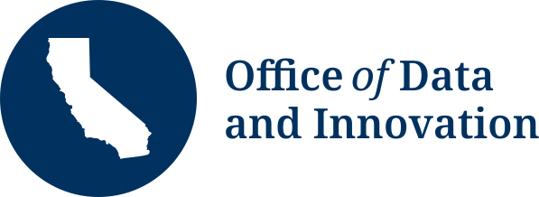

## Today's agenda {.agenda}

- **About me** *5 minutes*
- **Lecture: public data, public trust** *35 minutes*
- **Exercise: to publish or not to publish** *30 minutes*
- **Debrief** *10 minutes*

# About me

<!-- TODO: bio slides. The slides below are placeholders using the brand layouts. -->

## Hi, I'm Lucy {.flow-slide}

::: {.flow}
::: {.flow-step}
{fig-alt="Macalester College shield"}

BA in Geology, Macalester College
:::
::: {.flow-step}
{fig-alt="Water drop icon"}

Drinking water efficiency work
:::
::: {.flow-step}
{fig-alt="UC Berkeley logo"}

PhD in Environmental Science, Policy, and Management
:::
::: {.flow-step}
{fig-alt="California Department of Water Resources seal"}

Senior environmental scientist
:::
::: {.flow-step}
{fig-alt="Office of Data and Innovation logo"}

Senior data governance strategist
:::
:::





# A request lands on your desk

## The dilemma

::: {.quote-box .scenario}
A state department has county-level enrollment counts for a benefits program, broken out by race/ethnicity and age group.

A journalist has filed a Public Records Act request. Additionally, an advocacy group wants the table posted on the State's open data portal, data.ca.gov.

Some cells count only a handful of people. Many of those are American Indian and Alaska Native residents of small rural counties (using census terminology).
:::

## What would you do? {eyebrow="Poll"}

:::: {.columns}
::: {.column width="72%"}
::: {.poll-options}
**A. Publish as is.** The Public Records Act presumes access, and these are counts, not individual records.

**B. Suppress small cells.** Hide counts under 11, plus any cells that would let someone recover them, then publish.

**C. Aggregate.** Combine small counties into regions, or small groups into broader categories, so no cell is small.

**D. Consult first.** Hold the release until affected tribes have been consulted, then decide.

**E. Withhold.** Deny the request and keep the table off data.ca.gov, arguing that the privacy risk clearly outweighs the public interest in disclosure.
:::

::: {.poll-code}
Go to **menti.com** and enter code **9406 1118**  
_Only the first 50 answers will be logged, so chat with a neighbor and submit one answer for your pair!_
:::
:::
::: {.column .poll-qr width="28%"}
{fig-alt="QR code linking to the Mentimeter poll" width="240"}
:::
::::

# Public data vs. private data

Why the ethical bar is different for government than industry

## Why government data is different

::: {.highlights}
::: {.highlight}
### No exit
You can delete an app. You can't opt out of Medi-Cal eligibility checks, the DMV, or taxes. Collection happens under legal compulsion or real need.
:::
::: {.highlight}
### Public accountability
Agencies answer to voters, the Legislature, courts, and the State Auditor, not to shareholders.
:::
::: {.highlight}
### Duty to disclose
Government records are presumed open. Companies can protect data as trade secrets.
:::
::: {.highlight}
### Buy, not build
Much of the state's technology is procured. Contracts are where values get enforced.
:::
:::

## Same state, different rules

| Consideration | Businesses | State agencies |
|---|---|---|
| **Privacy law** | CCPA, as amended by the CPRA (Prop 24, 2020) | Information Practices Act of 1977 |
| **Core rule** | Consumer rights to know, delete, correct, and opt out of sale | Keep only information "relevant and necessary" to an authorized purpose |
| **Disclosure** | Trade secrets protected | California Public Records Act: access is a "fundamental and necessary right" |
| **Enforcement** | California Privacy Protection Agency and Attorney General | Agencies, courts, State Auditor, Legislature |

::: {.callout-definition title="Watch out: two CPRAs"}
**CPRA** means both the *California Privacy Rights Act* (businesses) and the *California Public Records Act* (government).^[@oag_ccpa; @cppa_about; @ca_ipa1977; @ca_cpra]
:::

## {.quote .two-quotes}

> "In framing a government which is to be administered by [people] over [people], the great difficulty lies in this: you must first enable the government to control the governed; and in the next place oblige it to control itself."

James Madison, *Federalist No. 51* [-@madison1788federalist51]

> "The right of privacy is the right to be left alone. It is fundamental and compelling."

George Moscone and Kenneth Cory, ballot argument for Proposition 11, which added privacy to California's Constitution [-@prop11_1972]

_Data is where this social contract bargain plays out today: the state collects what it needs to govern and serve, and owes the people it governs limits and accountability in return._

## What the social contract lens adds

- Government data collection is part of a **bargain**: people grant the state the power to collect, and the state owes them limits and accountability.
- The same data that delivers a benefit can also be used to deny, police, or surveil.
- So the questions aren't just *is it accurate?* and *is it secure?* but **for whom, by whom, and for what?**

::: {.takeaway .spaced}
### Key takeaway
In government, collecting data is a use of state power, so the ethical bar is often higher than in the private sector.
:::

# Transparency vs. privacy

Two public goods in tension

## Open by default...

- Open data supports accountability, research, journalism, and better services.
- **data.ca.gov** hosts thousands of state datasets from dozens of organizations.^[@datacagov_home]
- The California Open Data Policy (2019) sets the default.^[@cdt_tl1901]
- But open data excludes personal and confidential information, and each dataset should be reviewed against de-identification guidelines first.^[@od_handbook_guidelines]

## ...but minimize by design

- **Collect less.** The IPA limits agencies to information "relevant and necessary" to an authorized purpose.^[@ca_ipa1977]
- **Disclose carefully.** Agencies may not disclose personal information in a way that links it back to the individual, with listed exceptions.
- **Beware the mosaic effect.** Releases that look harmless on their own can identify people once combined.

::: {.takeaway .nudge}
### How easy is re-identification?
In 1990 Census data, an estimated 87% of the U.S. population was likely unique on just ZIP code, gender, and date of birth.^[@sweeney2000simple. Later estimates are lower but still substantial [e.g., @golle2006revisiting].]
:::

## Data minimization in practice: ODI's toolkit

::: {.callout-definition title="Data minimization"}
"Collecting and keeping the information you need and nothing more."^[@odi_minimization_101]
:::

::: {.highlights .light .unnumbered .roomy}
::: {.highlight}
### Ask before you collect
"Do I really need this information to fulfill my goal?" and "Will I actually use it to deliver a service or meet a legal requirement?" If not, don't collect or store it.
:::
::: {.highlight}
### Purpose limitation
Use data only for the reason it was collected, unless there's proper justification or consent.
:::
::: {.highlight}
### Minimum necessary
Access or share only what the task needs. For example, an eligibility worker doesn't need a full medical history.
:::
:::

ODI's data minimization toolkit grounds these principles in the Information Practices Act, and the Statewide Data Strategy pairs open data with **privacy by design** and **data minimization**.^[@odi_datastrategy_2026]

## The small numbers problem

California's health and human services agencies use shared de-identification guidelines.^[@calhhs_ddg2]

- Counts based on **fewer than 11 people** can trigger suppression.
- **Complementary suppression:** hide extra cells so the hidden ones can't be recovered from totals.
- Rates and percentages built on suppressed cells get suppressed too.

::: {.spaced-block}
::: {.callout-important title="The tension"}
Suppression protects individuals, but it can erase whole communities from the public record—often the smallest, most rural, and/or most marginalized.
:::
:::

## {.quote}

"What gets counted counts."

Joni Seager, as quoted in Catherine D'Ignazio and Lauren Klein, *Data Feminism* [-@dignazio2020data]

## Case: CalGang

CalGang is a shared gang database used by law enforcement across the state. In 2016, the State Auditor reviewed it.^[@csa_2015_130]

::: {.highlights .plain .stats}
::: {.highlight}
### 42
people were listed as younger than 1 year old when entered
:::
::: {.highlight}
### 13 of 100
individuals reviewed had no adequate support for being in the database
:::
::: {.highlight}
### 250+
people had purge dates more than 100 years in the future
:::
:::

**What changed:** AB 90 (2017) put CalGang in statute under Department of Justice oversight.^[@ca_ab90_2017] Poor data governance had become a civil rights problem.

## ODI in practice: Engaged California

A state deliberative-democracy platform, launched in 2025 with Los Angeles wildfire recovery, and statewide in 2026 on AI and work.^[@gov_engaged_2025; @engaged_ai; @engaged_about; @engaged_lafires_insights]

- Participation is anonymous, and names aren't revealed.
- Comment data is published openly, without personally identifying information.
- GenAI helped find themes in comments, with staff reviewing and editing the results.
- The [analysis code is public on GitHub](https://github.com/cagov/caldata-engaged-california), so anyone can see how the findings were reached (though this requires technical skills).

::: {.takeaway .nudge}
### Key takeaway
Transparency about *process* can matter as much as transparency about *data*.
:::

# Tribal data sovereignty

Tribes are sovereign governments, not stakeholders

## {.quote}

"Indigenous experiences under colonial control suggest that data more often means 'something taken'."

Desi Rodriguez-Lonebear, "Building a Data Revolution in Indian Country" [-@rodriguezlonebear2016building]

## What is Indigenous data sovereignty?

::: {.big-callout}
::: {.callout-definition title="Indigenous data sovereignty"}
"Indigenous Data Sovereignty recognizes Indigenous Peoples' inherent rights to access, use, and steward data critical for effective governance, and to govern those data according to their own values, principles, and practices."^[@usidsn_summit]
:::
:::

::: {.highlights .light .unnumbered .roomy .spaced-top}
::: {.highlight}
### Taken without consent
Blood given by Havasupai Tribe members for diabetes research at Arizona State University was reused for unrelated studies. The university settled in 2010 and returned the samples.
:::
::: {.highlight}
### Mismanaged
*Cobell v. Salazar*: a 15-year class action over the federal government's management of individual Indian trust accounts and land. Settled for $3.4 billion in 2011.
:::
::: {.highlight}
### Miscounted
The 2020 Census undercounted American Indian and Alaska Native people living on reservations by 5.64%, more than any other group.^[@mello2010havasupai; @doi_cobell_2011; @census_pes_2022]
:::
:::

## {.quote .two-quotes .paired}

> "The danger in damage-centered research is that it is a pathologizing approach in which the oppression singularly defines a community."

> "Even when communities are broken and conquered, they are so much more than that—so much more that this incomplete story is an act of aggression."

Eve Tuck, "Suspending Damage: A Letter to Communities" [-@tuck2009suspending, pp. 413, 416]

## CARE alongside FAIR

FAIR (Findable, Accessible, Interoperable, Reusable) is about making data easy to share and reuse.^[@wilkinson2016fair] CARE adds people and purpose.^[@gida2019care; @carroll2020care]

::: {.highlights .light .unnumbered .two-col .spaced-top}
::: {.highlight}
### Collective benefit
"Data ecosystems shall be designed and function in ways that enable Indigenous Peoples to derive benefit from the data."
:::
::: {.highlight}
### Authority to control
"Indigenous Peoples' rights and interests in Indigenous data must be recognised and their authority to control such data be empowered."
:::
::: {.highlight}
### Responsibility
"Those working with Indigenous data have a responsibility to share how those data are used to support Indigenous Peoples' self-determination and collective benefit."
:::
::: {.highlight}
### Ethics
"Indigenous Peoples' rights and wellbeing should be the primary concern at all stages of the data life cycle and across the data ecosystem."
:::
:::

## California context

::: {.timeline}
::: {.step}
### 2011
EO B-10-11^[@eo_b_10_11]

#### Consultation
Creates the Governor's Tribal Advisor and directs agencies to consult with California tribes
:::
::: {.step}
### 2017
CalHHS policy^[@calhhs_tcp_2017]

#### Agency policies
Departments adopt tribal consultation policies, though most don't address data
:::
::: {.step}
### 2019
EO N-15-19^[@eo_n_15_19]

#### Apology
Formal state apology and the Truth and Healing Council
:::
::: {.step}
### 2025
AB 1004; CNRA policy^[@ca_ab1004; @cnra_tcp_2025]

#### Sovereign records
Tribal financial records shared with agencies are exempt from disclosure as "records of a sovereign nation"
:::
::: {.step}
### Now
CNRA toolkit^[@cnra_ids_toolkit]

#### Data sovereignty
Guidance on Indigenous data sovereignty for state partners handling tribal data in natural resource contexts
:::
:::

## {.quote}

"Each standard and each category valorizes some point of view and silences another."

Geoffrey Bowker and Susan Leigh Star, *Sorting Things Out* [-@bowker1999sorting]

## What this means in practice

:::: {.columns}
::: {.column width="46%"}
### Categories aren't nations
"American Indian and Alaska Native" is a federal race category. It isn't the same as tribal nations or tribal citizenship, and it isn't a tribe's own definition.^[@walter2013indigenous]

### From damage to desire
Tuck's alternative: "desire-based research frameworks are concerned with understanding complexity, contradiction, and the self-determination of lived lives."^[@tuck2009suspending, p. 416.]
:::
::: {.column width="6%"}
:::
::: {.column width="48%"}
::: {.callout-recommendation title="Best practices for state entities"}
- Consult **before** collecting or publishing, not after
- Put data sharing agreements in writing
- Let tribes review products that identify them
- Respect a decision **not** to publish
- Ask what benefit flows back to the community
- Document strengths and aspirations, not only harm
:::

::: {.read-this}
**If you read one thing from this lecture,** make it Eve Tuck's [*Suspending Damage: A Letter to Communities*](https://doi.org/10.17763/haer.79.3.n0016675661t3n15).
:::
:::
::::

# (Gen)AI governance

When decisions are automated, who's accountable?

## When automation goes wrong

**California EDD, 2020–21:** under pressure from pandemic-era fraud, the Employment Development Department used a fraud-scoring tool to flag and suspend unemployment claims.

::: {.highlights .plain .stats}
::: {.highlight}
### 1.1M
claims suspended, with no advance notice to claimants^[@lao_ui_fraud_2022]
:::
::: {.highlight}
### 600K+
of those were later found to be legitimate
:::
::: {.highlight}
### $10B+
paid on fraudulent claims, which drove the crackdown^[@csa_2020_628_2]
:::
:::

::: {.takeaway}
### Key takeaway
If algorithms aren't carefully designed, automated decisions can fail at scale, and the cost often falls on the people with the least power to contest them.
:::

## {.quote}

The New Jim Code: "the employment of new technologies that reflect and reproduce existing inequities but that are promoted and perceived as more objective or progressive than the discriminatory systems of a previous era."

Ruha Benjamin, *Race After Technology* [-@benjamin2019race, p. 6]

## How California governs AI

::: {.timeline}
::: {.step}
### 2023
EO N-12-23; AB 302^[@eo_n_12_23; @ca_ab302]

#### Foundations
GenAI executive order; inventory of high-risk automated decision systems
:::
::: {.step}
### 2024
Guidelines; SB 896^[@genai_guidelines_2024; @cdt_tl2401; @ca_sb896]

#### Rules of the road
Procurement guidelines, GenAI risk assessments, and disclaimers plus a path to reach a human
:::
::: {.step}
### 2025
State policy; SB 53^[@cdt_tl2501; @ca_sb53]

#### Policy, then regulation
GenAI policy in the State Administrative Manual; frontier developer transparency (the state as regulator)
:::
::: {.step}
### 2026
EO N-5-26^[@eo_n_5_26]

#### Trusted procurement
Vendor attestations on bias, civil rights, and privacy
:::
:::

## ODI in practice: AskCA

AskCA is an AI assistant that helps Californians find state services, built by ODI and launched as a prototype on October 1, 2026.^[@gov_askca_2026; @askca_about; @askca_privacy; @askca_conditions; @askca_notice]

- Chats are kept for 60 days to improve answers, then deleted or anonymized.
- Conversations aren't used to train the underlying model.
- Users are told not to enter Social Security numbers or health information.
- Collected information may be a public record, subject to exemptions.
- Users are notified of privacy and data collection practices.

**_Want to sign up for the beta release? Go to ask.ca.gov!_**

## Questions AskCA raises that the beta release is investigating

::: {.highlights .light .unnumbered .with-sources}
::: {.highlight}
### Accuracy
"This tool may not always get things right." What's an acceptable error rate for this kind of tool?

AskCA: check the source links; accuracy isn't guaranteed. [About](https://ask.ca.gov/about) · [Conditions of use](https://ask.ca.gov/conditions-of-use)
:::
::: {.highlight}
### A path to a human
SB 896 requires a disclaimer and a way to reach a person. What does a good path look like?

AskCA: email and in-chat feedback, no live human support. [Conditions of use](https://ask.ca.gov/conditions-of-use) · [About](https://ask.ca.gov/about)
:::
::: {.highlight}
### Public records
Are GenAI chat logs public records? How do you balance transparency with users' privacy?

AskCA: collected information is a public record, with exemptions. [Privacy policy](https://ask.ca.gov/privacy-policy) · [Notice on collection](https://ask.ca.gov/privacy-notice-on-collections)
:::
::: {.highlight}
### Minimization
What is the right retention period? Who decides, and based on what considerations?

AskCA: chats kept 60 days. [Privacy policy](https://ask.ca.gov/privacy-policy)
:::
::: {.highlight}
### Vendor transparency
Which model and vendors sit behind a public service, and where should the public learn that?

AskCA: "third-party service providers." [Notice on collection](https://ask.ca.gov/privacy-notice-on-collections)
:::
::: {.highlight}
### Accountability
If a GenAI answer leads someone to miss a deadline, who's responsible?

AskCA: ODI disclaims liability for errors and omissions. [Conditions of use](https://ask.ca.gov/conditions-of-use)
:::
:::

# Putting it together

## How ODI approaches this work

::: {.highlights}
::: {.highlight}
### Open by default
Publish what the public needs for government transparency and trust.
:::
::: {.highlight}
### Minimize by design
Collect and keep only what the purpose requires.
:::
::: {.highlight}
### Center people
Start from the needs of the people the data describes and serves.
:::
::: {.highlight}
### Govern (Gen)AI
Assess risk, disclose use, test before deploying, and keep humans in the loop.
:::
:::

## Questions to ask of any public dataset

::: {.arrow-list .large}
- What is the purpose?
- Is it necessary?
- What harms are possible?
- Who decides?
- Who is accountable?
- Who is missing?
:::

::: {.takeaway .spaced}
### Key takeaway
The suppression threshold you'll pick in a few minutes is a value choice. As Langdon Winner put it, "the things we call 'technologies' are ways of building order in our world."^[@winner1980artifacts, p. 127.]
:::

# Exercise

To publish or not to publish · 30 minutes

## The exercise

::: {.timeline}
::: {.step}
### Part 1

#### Explore
Load the table and find the smallest cells
:::
::: {.step}
### Part 2

#### Suppress
Apply a small-cell rule and see who disappears
:::
::: {.step}
### Part 3

#### Recover
Rebuild hidden cells from totals, then fix it
:::
::: {.step}
### Part 4

#### Link
Re-identify a fictional person by joining two datasets
:::
::: {.step}
### Part 5

#### Decide
Write a one-paragraph recommendation to your director
:::
:::

::: {.big-callout}
::: {.callout-definition title="The small-cell rule"}
Hide any count of **1 to 10 people**, so no one can be singled out from a tiny group. Zeros are shown. This follows California's health and human services de-identification guidelines.^[@calhhs_ddg2]
:::
:::

## Complementary suppression, step by step

::: {.cs-grid}
[]{.cs-label}[0–17]{.cs-head}[18–34]{.cs-head}[35–64]{.cs-head}[65+]{.cs-head}[Total]{.cs-head}[]{.cs-note}

[**1. Hide the small cell**]{.cs-label}[29]{.tile}[19]{.tile}[17]{.tile}[?]{.tile .t-hidden}[75]{.tile .t-total}[The 65+ count (10) is under 11, so it's hidden.]{.cs-note}

[**2. Someone does the math**]{.cs-label}[29]{.tile}[19]{.tile}[17]{.tile}[10]{.tile .t-exposed}[75]{.tile .t-total}[75 − 29 − 19 − 17 = 10. The total gives it away.]{.cs-note}

[**3. Hide one more cell**]{.cs-label}[29]{.tile}[19]{.tile}[?]{.tile .t-hidden}[?]{.tile .t-hidden}[75]{.tile .t-total}[The two add up to 27, but is it 17&nbsp;+&nbsp;10? 20&nbsp;+&nbsp;7? 26&nbsp;+&nbsp;1? No way to tell.]{.cs-note}
:::

::: {.takeaway .nudge}
### The rule in the exercise
Keep hiding the next-smallest cell in the row until at least **two** cells are hidden and they add up to **11 or more**.
:::

## Get set up

Work on your own or in pairs.

```bash
git clone https://github.com/lucy-gov/data-ethics-lecture.git
cd data-ethics-lecture
uv sync
uv run jupyter lab exercise/
```

::: {.spaced-block}
::: {.callout-data-note}
**All data here is synthetic.** County names are real and county sizes are roughly realistic, but every count and every person is made up. No real program, community, or tribe is represented.
:::
:::

# Debrief

## What you found

::: {.highlights .plain .stats}
::: {.highlight}
### 28 → 0
hidden cells could be worked out from the published totals, until complementary suppression closed the gap
:::
::: {.highlight}
### 15% → 29%
of AIAN enrollees in small counties were hidden, before and after complementary suppression
:::
::: {.highlight}
### 17 of 372
"de-identified" records were matched to a name using only ZIP code, birth year, and sex
:::
:::

::: {.takeaway .spaced}
### Key takeaway
Each fix for privacy had a "cost," and the cost landed on the same small communities.
:::

## Concept: small-cell suppression

Alpine County, White enrollees (synthetic data from the exercise):

::: {.big-table}
| | 0–17 | 18–34 | 35–64 | 65+ | **Total** |
|---|---|---|---|---|---|
| **True count** | 29 | 19 | 17 | 10 | 75 |
| **Published** | 29 | 19 | 17 | [hidden]{.cell-hidden} | 75 |
:::

::: {.spaced-block}
::: {.callout-definition title="Small-cell suppression"}
Hide any count based on **fewer than 11 people**, so no one can be singled out from a tiny group. Zeros are usually shown.
:::
:::

## Concept: working backward

The row total is still published. One hidden cell plus a total is one equation with one unknown:

::: {.equation}
75 − 29 − 19 − 17 = **10**
:::

With complementary suppression, one more cell is hidden:

::: {.big-table}
| | 0–17 | 18–34 | 35–64 | 65+ | **Total** |
|---|---|---|---|---|---|
| **Published** | 29 | 19 | [hidden]{.cell-hidden} | [hidden]{.cell-hidden} | 75 |
:::

::: {.big-callout}
::: {.callout-definition title="Complementary suppression"}
Hide **extra** cells so the hidden ones can't be recovered from totals. Now 35–64 + 65+ = 27, but there's no way to tell how it splits. The cost: a cell of 17 people disappears too.
:::
:::

## Concept: linking datasets

:::: {.columns}
::: {.column width="47%"}
**"De-identified" extract** (no names)

| record | ZIP | born | sex | benefit |
|---|---|---|---|---|
| R0279 | 96120 | 1957 | F | $350 |
:::
::: {.column width="6%"}
:::
::: {.column width="47%"}
**Public roster** (names, no benefits)

| name | ZIP | born | sex |
|---|---|---|---|
| Max Lopez | 96120 | 1957 | M |
| [Ruth Calloway]{.cell-match} | 96120 | 1957 | F |
:::
::::

A **join** lines up rows from two tables that share values in the same columns. ZIP code and birth year narrow 3,000+ residents to two people; sex narrows it to one.

::: {.spaced-block}
::: {.callout-definition title="Quasi-identifiers"}
Ordinary details like ZIP code, birth year, and sex that don't name anyone alone, but often do in combination. Half the records in the extract were unique on just these three.
:::
:::

## Let's discuss

::: {.highlights .light .unnumbered .two-col .roomy}
::: {.highlight}
### Trade-offs
Suppression, aggregation, or not publishing: what does each cost, and who pays?
:::
::: {.highlight}
### Who decides
Whom should the department have consulted about the AIAN rows, and when? ("AIAN" is a race category, not a tribal nation.)
:::
::: {.highlight}
### Damage vs. desire
In this exercise, AIAN enrollees showed up only as a privacy risk. Was your memo damage-centered? What would a desire-based release look like?
:::
::: {.highlight}
### Linkage
What does "de-identified" actually promise? What should the department have removed before sharing the extract?
:::
:::

## Has your answer changed? {eyebrow="Poll"}

:::: {.columns}
::: {.column width="72%"}
::: {.poll-options}
**A. Publish as is.** The Public Records Act presumes access, and these are counts, not individual records.

**B. Suppress small cells.** Hide counts under 11, plus any cells that would let someone recover them, then publish.

**C. Aggregate.** Combine small counties into regions, or small groups into broader categories, so no cell is small.

**D. Consult first.** Hold the release until affected tribes have been consulted, then decide.

**E. Withhold.** Deny the request and keep the table off data.ca.gov, arguing that the privacy risk clearly outweighs the public interest in disclosure.
:::

::: {.poll-code}
Go to **menti.com** and enter code **9406 1118**
:::
:::
::: {.column .poll-qr width="28%"}
{fig-alt="QR code linking to the Mentimeter poll" width="240"}
:::
::::

## My take: two decisions, not one

:::: {.columns}
::: {.column width="49%"}
::: {.callout-note title="Decision 1, the records request: B"}
- The Public Records Act is an **obligation**: release the parts of a record that can be separated out, and justify anything withheld.^[@ca_cpra]
- Suppress small and complementary cells, cite privacy for those cells only, and release the rest on time.
- Never share record-level data with quasi-identifiers like ZIP, birth year, and sex intact.
:::
:::
::: {.column width="2%"}
:::
::: {.column width="49%"}
::: {.callout-recommendation title="Decision 2, posting on data.ca.gov: D, then maybe C"}
- Publication is **discretionary**, so this is where consultation belongs.
- Ask affected tribes how the data should look. The answer may be aggregation, an agreed suppression approach, or data-sharing agreements instead of posting.
- Working out *who* to consult about "AIAN" rows is itself the classification problem.
:::
:::
::::

::: {.takeaway}
### The real lesson
The decision is already late. These questions belong at collection and publication planning, with tribes at the table, not on a records-request deadline.
:::

## References {.references-slide eyebrow=""}

::: {#refs}
:::

## Thank you {.closing}

Questions?
